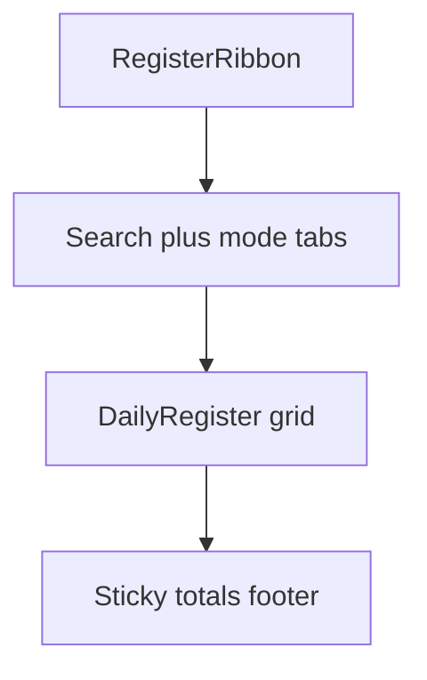

# Daily Register chrome — design mockup

Visual preview for the Table page redesign (Cashier / Accountant).  
**Status:** design review — not implemented yet.

## Mockup images

| View | File | Intent |
|------|------|--------|
| Sidebar open, full ribbon | [daily-register-chrome-mockup.jpg](daily-register-chrome-mockup.jpg) | Target look: grouped Excel-style ribbon + slim title + mode strip + grid |
| Narrow / overflow | [daily-register-chrome-overflow-mockup.jpg](daily-register-chrome-overflow-mockup.jpg) | Same chrome with a `More »` menu for actions that do not fit |

> AI mockups are directional. Treat the specs below as source of truth if an image disagrees (e.g. stray “9px” captions, totals still in the middle header, Filter misplaced, overflow menu not under the ribbon).

---

## Problem we are fixing

Today’s [`QbTxnToolbar`](../../tahmeed/ui/widgets/qb_txn_toolbar.py) puts ~25 actions in one flat row. Labels only expand when the window is maximized, so with the **sidebar open** captions truncate (`Da…es`, `Su…ay`, `Att…ile`). Totals also compete for space in a heavy `_QBDocHeader`.

## Target stack (top → bottom)

```text
┌─ Sidebar ─┬──────────────────────────────────────────────────────────────┐
│ (unchanged│  RIBBON  Clipboard│Font│Find│Entries│Day│Data│View │ More» │
│  leave it)│  (exact qtawesome icons · group captions · overflow)        │
│           ├──────────────────────────────────────────────────────────────┤
│           │  🔍 Search Ctrl+K │ My · Parked · Skipped · Merged │ date…  │
│           ├──────────────────────────────────────────────────────────────┤
│           │  S/NO │ Date │ Item │ Description │ … │ TZS │ USD │ …       │
│           │  …… dense Excel-like grid ……                                 │
│           ├──────────────────────────────────────────────────────────────┤
│           │  footer ONLY · REFUND / USD / TOTAL · Totals·P.totals·Comb. │
└───────────┴──────────────────────────────────────────────────────────────┘
```



---

## 1. Ribbon (Excel simplified / Separate Expenses family)

Pattern reference: [`FeedRibbonToolbar`](../../tahmeed/ui/widgets/feed_ribbon_toolbar.py) (~86px, icon above label, group captions, KPIs far right).

**Height:** ~80–86px  
**Background:** `#F8FAFC` · border `#E5E7EB` · accent `#0077C5` · text `#1B2B4B`

### Groups (left → right)

| Group | Actions | Notes |
|-------|---------|--------|
| Clipboard | Undo, Redo | Always visible |
| Font | Larger, Smaller, Wrap | Always visible |
| Find | Find (+ prev/next) | Light-blue emphasis like feed Find |
| Entries | New, Save, Delete, Copy, Clear | Save never goes to overflow |
| Day | Today, Edit/Cancel, Submit day, Day Issues | Primary day workflow |
| Data | Print, Export ▾, Import, Attach File | Export keeps format menu |
| View | Filter | Toggle state (checked = blue) |
| Context | Fix trucks, Clear parked **or** Revive, Discard | Only on Parked / Skipped |
| KPIs (far right) | Refund · USD · Total stacks | See totals section |
| Overflow | `More »` | Appears when width is tight |

### Responsive rules

1. Toolbar **never wraps** to a second row of buttons.
2. When the sidebar is open / window is narrow: keep Clipboard, Font, Find, Entries (at least New/Save/Delete); collapse Day/Data/View/Context into **More »**.
3. Overflow menu rows show **icon + full text** (no ellipsis).
4. Tooltips always show full name + shortcut.
5. Drop the maximize-only label hack for Table; width-driven overflow replaces it.

### What we are *not* doing

- Full multi-tab Office ribbon (Home / Insert / Page Layout / …) — cashiers stay on one Home strip.
- Purple / glow / card-heavy “AI dashboard” chrome.

---

## 2. Middle header card — removed

The old `_QBDocHeader` card between the ribbon and the table is **gone**.  
No slim title row and **no money tiles** in the middle. Chrome is:

`Ribbon → Search / mode strip → Grid → Sticky footer totals`

---

## 3. Filter / mode strip

Match Separate Expenses chrome bar:

| Zone | Content |
|------|---------|
| Left | Search (`Ctrl+K`) |
| Center | Mode pills: My entries · Parked · Skipped · Merged (counts as badges) |
| Right | Reconciled Date · Cheque |

Day actions live in the ribbon **Day** group, not as a second button row.

---

## 4. Totals — footer only (readability pass)

| Surface | Shows |
|---------|--------|
| Sticky grid footer | Three clear columns — see below |
| Ribbon | No KPI stacks |
| Middle card | Removed |

**Implemented footer layout:** one band, three equal columns side by side.

Each column has a **centered** title (`REFUND TO FLOAT` · `TOTAL USD` · `TOTAL`) over three cells — Totals / P. totals / Combined — with labels centered over **larger** amounts.

Mockup: [register-footer-centered-titles-mockup.jpg](register-footer-centered-titles-mockup.jpg)

Colors: My muted · Parked amber `#B45309` · Combined blue `#0077C5`

---

## 5. Grid

- Keep current Calibri register look in [`excel_grid.py`](../../tahmeed/ui/cashier/excel_grid.py) (density plan already left this alone).
- Dense rows, dark header, right-aligned money.
- Sticky footer as above.
- Freeze leading identity columns so horizontal scroll does not lose context.

---

## Before → after (chrome)

| Today | Target |
|-------|--------|
| Flat icon strip, labels truncate with sidebar | Grouped ribbon + `More »` overflow |
| Labels only when maximized | Labels (or overflow text) at all useful widths |
| Fat header with three money stacks | Slim title; money on ribbon + footer |
| Mode strip + overloaded toolbar | Mode strip = navigation only; actions in ribbon |
| Separate Expenses already ribbon-like | Daily Register joins the same family |

---

## Implementation map (when approved)

| Piece | Primary files |
|-------|----------------|
| Ribbon | `tahmeed/ui/widgets/qb_txn_toolbar.py` (evolve) or new `register_ribbon_toolbar.py`; reuse patterns from `feed_ribbon_toolbar.py` |
| Wiring | `tahmeed/ui/cashier/dashboard.py` (`_TablePage`) |
| Slim header / KPI move | `_QBDocHeader` + ribbon KPI host |
| Mode strip | `_ActionBar` |
| Footer polish | `tahmeed/ui/cashier/excel_grid.py` |
| Accountant | Same `_TablePage` reuse |

---

## Review checklist

Please mark anything you want changed before we build:

- [ ] Ribbon group order / names
- [ ] Which actions must stay visible when sidebar is open
- [ ] Totals: ribbon KPIs + footer (as proposed)
- [ ] Keep single Home strip (no Excel multi-tabs)
- [ ] Visual kinship with Separate Expenses ribbon (Tahmeed blue, not WPS green)
- [ ] Mockup images feel close enough after reading this spec

When this doc is signed off, implement chrome only — no register row-density rewrite.
